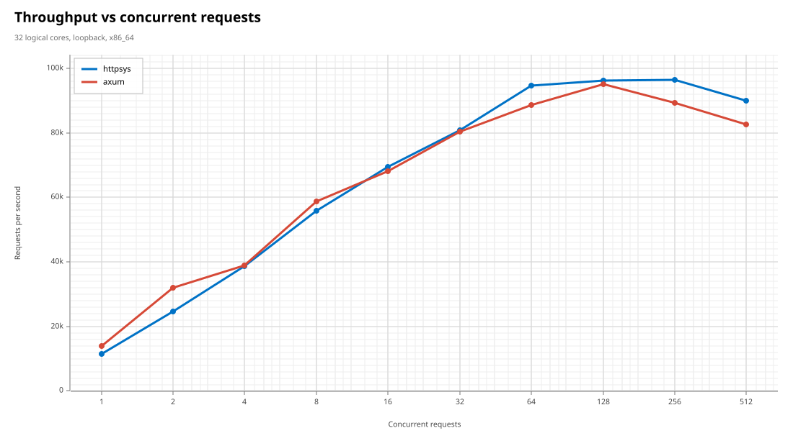
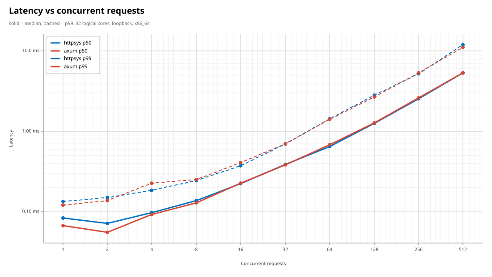
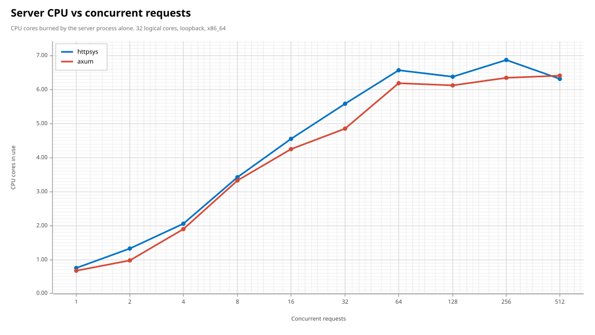
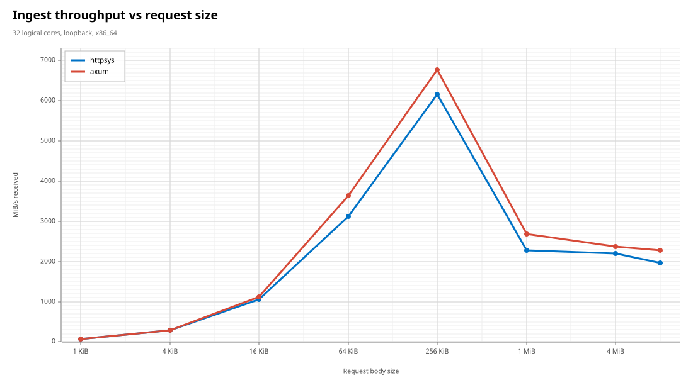
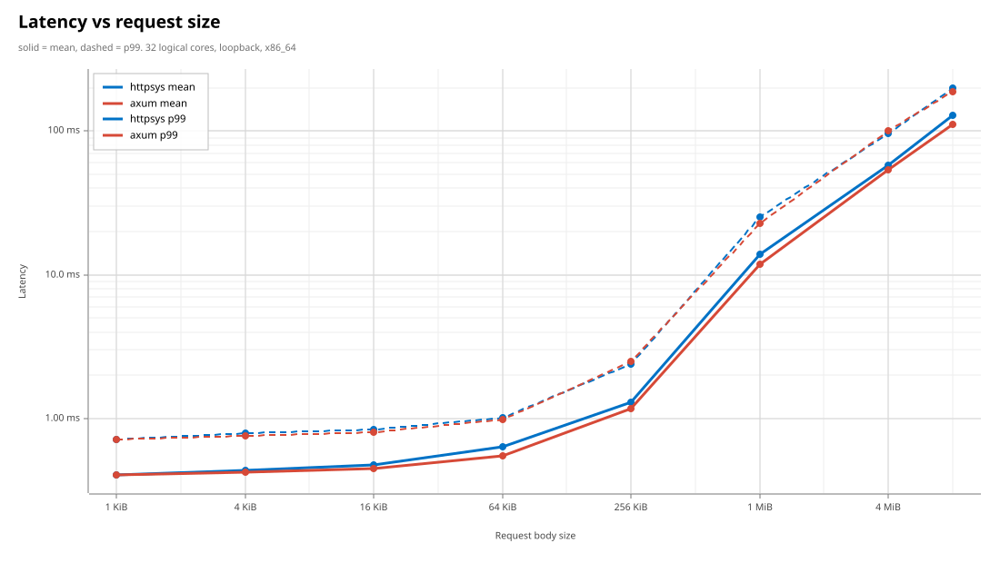
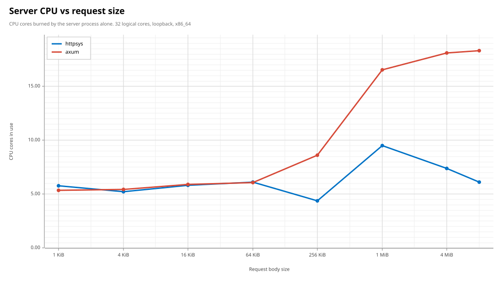

# Benchmark results

How `httpsys` compares with [axum](https://github.com/tokio-rs/axum), and how
to reproduce the numbers.

## Results

32 logical cores, loopback, `--duration 4 --warmup 1`. Numbers move a few
percent run to run; the shapes are stable. Raw per-point data is in
[charts/results.csv](../charts/results.csv).

| | httpsys | axum | |
| --- | ---: | ---: | --- |
| Peak throughput, small requests | **96.4k req/s** | 95.1k req/s | |
| Throughput at 256 connections | **96.4k req/s** | 89.3k req/s | httpsys holds its peak |
| Median latency at 1 connection | 84 µs | **67 µs** | axum wins when idle |
| Ingest at 256 KiB bodies | 6167 MiB/s | **6770 MiB/s** | |
| Ingest at 8 MiB bodies | 1973 MiB/s | **2278 MiB/s** | |
| Server CPU at 8 MiB bodies | **6.10 cores** | 18.32 cores | 2.6x more efficient per byte |








Reading them honestly:

- **Many small requests — httpsys wins, and holds on longer.** Peak throughput
  is only a nose ahead, but the useful difference is at the top of the curve:
  httpsys is still at its peak with 256 connections in flight, where axum has
  already given up 6%.
- **Low concurrency — axum wins.** With a handful of connections in flight, a
  plain socket read beats a kernel-mode request queue on raw latency. There is
  per-request bookkeeping inside http.sys that a userspace parser simply does
  not do.
- **Ingest throughput — axum wins by about 10%.** This one is structural: a
  socket read copies bytes from the TCP buffer straight into user memory,
  while http.sys buffers the entity body in kernel pool first and copies from
  there. That extra hop is not something a user-mode wrapper can remove, and
  six rounds of optimisation only narrowed it from 2.7x to 1.1x.
- **CPU on large uploads — httpsys wins outright, by a lot.** At 8 MiB bodies
  it delivers 87% of axum's throughput for **33% of the CPU**, because http.sys
  does the framing and buffering in the kernel instead of running a parser over
  every byte in user space.

The short version: if you are serving many small requests, or you care what
large uploads cost you in CPU, http.sys is the better substrate. If you want
the last 10% of raw upload bandwidth on a single box, a socket is.

## Running the benchmark

```ps
cargo build --release

# Full sweep against both engines, writes SVG charts + results.csv
.\target\release\httpbench.exe bench --out charts

# Run one server
.\target\release\httpbench.exe serve --engine httpsys --port 8080

# Drive a running server
.\target\release\httpbench.exe load --port 8080 -c 64 -d 10s -s 64KiB
```

`bench` spawns each engine as a child process, drives it with a closed-loop
HTTP/1.1 load generator built on raw hyper connections, and brackets every
measured window with `GetProcessTimes` snapshots of the *server* process — so
the CPU numbers exclude the load generator entirely.

Both servers expose the same endpoint and do the same work per request: read
the whole request body, reply `200 OK` with a two-byte `text/plain` body.
`TCP_NODELAY` is set on both sides.

### URL reservations

http.sys requires a URL reservation. Either grant one once, as administrator:

```ps
netsh http add urlacl url=http://+:8080/ user=Everyone
netsh http add urlacl url=http://+:8081/ user=Everyone
```

…or reuse the reservation Windows already grants to `\Everyone`, which needs
no elevation at all:

```ps
.\target\release\httpbench.exe bench `
    --ports 80,8081 --path /Temporary_Listen_Addresses/bench/
```
